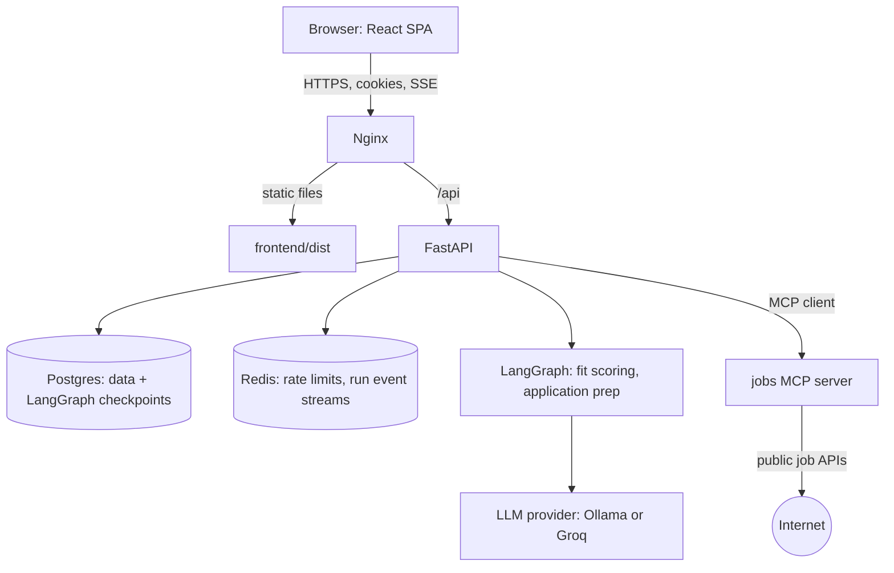

# ApplyIQ

An AI job-application copilot. It reads your resume, finds and scores jobs, drafts a tailored resume and cover letter for one job at a time, and tracks the application. Nothing leaves the system until you approve it, and it never submits an application for you.

> **Status: in development.** The design is settled and the build is under way. Nothing is deployed yet. This README describes what the finished system does; `TRACKER.md` shows what exists today.

## What is worth looking at

1. **Drafts that cannot invent experience.** Every sentence in a draft cites the profile facts it came from. A rule-based guard checks names, numbers, dates and skills against those facts, then a model judges whether each claim is supported or overstated. Anything unsupported is shown with a dashed underline and blocks approval. Design: [docs/application-prep.md](docs/application-prep.md).
2. **A human approves every change.** The drafting agent is a LangGraph graph that pauses on an interrupt. It resumes only on your decision: approve, ask for changes, or reject. The run survives a server restart because its state is checkpointed in Postgres.
3. **Untrusted text is treated as untrusted.** Job descriptions come from the internet. They are reduced to a structured brief by a model call that has no tools, and the only process that talks to the open internet is an MCP server that holds no database credentials. Threat model: [SECURITY.md](SECURITY.md).

## How it fits together

## Stack

| Layer | Choice |
|---|---|
| Backend | Python 3.14, FastAPI, Pydantic v2, SQLAlchemy 2 (async, psycopg 3), Alembic |
| Agents | LangGraph with a Postgres checkpointer |
| Tools | One FastMCP server for job sources |
| LLM | Swappable provider: Ollama locally, Groq when hosted |
| Data | PostgreSQL, Redis |
| Frontend | React 18 with Vite, plain JavaScript, React Router, TanStack Query, CSS Modules |
| Infra | Docker, Nginx, GitHub Actions |

## Run it locally

Not available yet. This section will be filled in when the foundation phase is merged. The planned commands are in [docs/tooling.md](docs/tooling.md).

## Tests and evaluation

Not available yet. The plan is unit and integration tests with mocked models, graph tests that drive the compiled graph with a fake model, and a grounding evaluation on a fixed set of synthetic profiles and jobs. The results table below will be filled from that evaluation.

| Check | Result |
|---|---|
| Seeded fabrications caught by the rule-based guard | to be measured |
| Clean drafts wrongly flagged | to be measured |
| Claims judged supported, by model | to be measured |
| Cost per prepared application | to be measured |

## What it will not do

- Submit applications or automate a browser against job sites.
- Scrape sites whose terms forbid it. Jobs come from public APIs and from text you paste.
- Invent skills, employers or dates.

## Job data

Job listings come from [Himalayas](https://himalayas.app) and [Jobicy](https://jobicy.com), and from public company job boards hosted on Greenhouse and Ashby. Each listing is shown with a credit and a link to its source. Details and terms: [docs/job-sources.md](docs/job-sources.md).

## Project documents

| File | What it holds |
|---|---|
| [PRD.md](PRD.md) | Problem, goals, non-goals, priorities |
| [ARCHITECTURE.md](ARCHITECTURE.md) | Stack, components, data model, API |
| [DESIGN.md](DESIGN.md) | The black-and-white "paper and desk" interface |
| [SECURITY.md](SECURITY.md) | Threat model and controls |
| [RULES.md](RULES.md) | How code is written and reviewed here |
| [MEMORY.md](MEMORY.md) | Decision log, with the reason for each decision |
| [TRACKER.md](TRACKER.md) | Phases and progress |

This project is built with Claude Code using a spec-first workflow: every feature starts as a written spec in `.claude/specs/`, ships on its own branch, and merges through a reviewed pull request.

## Licence

To be decided before the first public release.
